<div align="center">


# Flashcards

### Build your own English vocabulary, one card at a time.

A calm, fast, installable flashcard app for learners of English. Add the words **you** care about, flip through them, practice the tricky ones, and watch your streak grow. Everything stays private in your browser.


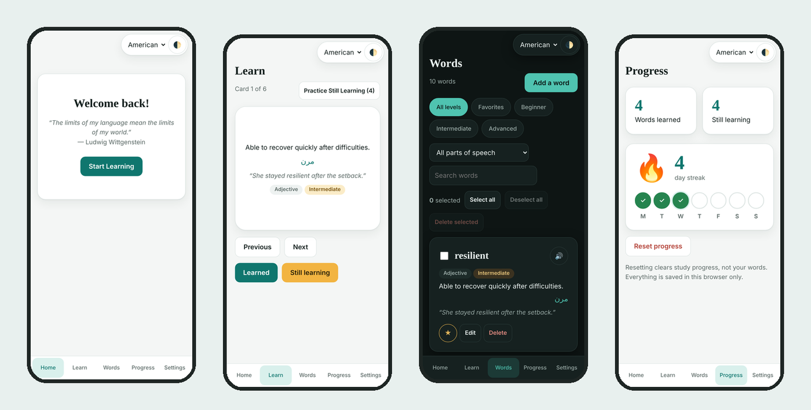

</div>

---

## Contents

[The idea](#the-idea) · [A quick tour](#a-quick-tour) · [How to use it](#how-to-use-it) · [How a word moves](#how-a-word-moves-through-the-app) · [Streaks](#how-the-streak-works) · [Pronunciation](#pronunciation) · [Light & dark](#light--dark-mode) · [Your data](#your-data-and-privacy) · [Install](#install-it-as-an-app) · [Run it](#run-it-yourself) · [Project structure](#project-structure) · [FAQ](#faq)

---

## The idea

Most vocabulary apps hand you a fixed list. **Flashcards works the other way around:** the app starts empty, and you build a personal collection from the words you meet while reading, watching, or working. Each word becomes a card with its meaning, part of speech, level, an optional Arabic meaning and an optional example sentence.

Then the app helps you remember them:

- **Learn** flips through your cards and sorts each word into *Learned* or *Still learning*.
- **Practice Still Learning** is a focused session for the words that haven't stuck yet.
- **Progress** shows how many words you know and keeps a weekly streak going.

There are no accounts, no ads and no server. The interface is entirely in English, and it is designed with Arabic-speaking learners in mind (you can store an Arabic meaning for every word).

<div align="center">
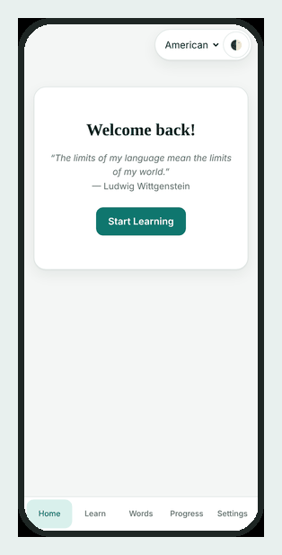
<br><sub>A tour of the five main screens</sub>
</div>

---

## A quick tour

| Screen | What it is for |
|---|---|
| 🏠 **Home** | A friendly welcome, a random motivational quote, and a **Start Learning** button. |
| 🃏 **Learn** | Flip cards for all words that are not yet learned. |
| 🌱 **Practice** | A separate session using *only* words marked Still learning. |
| 📚 **Words** | Your library: add, edit, delete, favorite, filter, search, and bulk-delete. |
| 📈 **Progress** | Words learned, words still learning, and your weekly streak. |
| ⚙️ **Settings** | Export your data to a JSON backup and import it again. |

<table>
<tr>
<td align="center"><b>Desktop · Light</b></td>
<td align="center"><b>Desktop · Dark</b></td>
</tr>
<tr>
<td>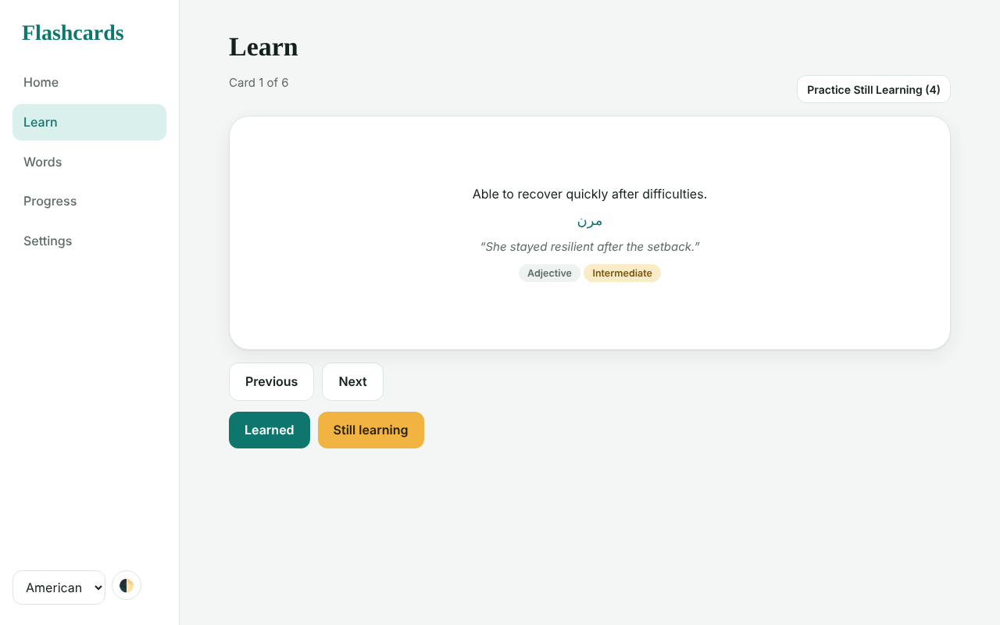</td>
<td>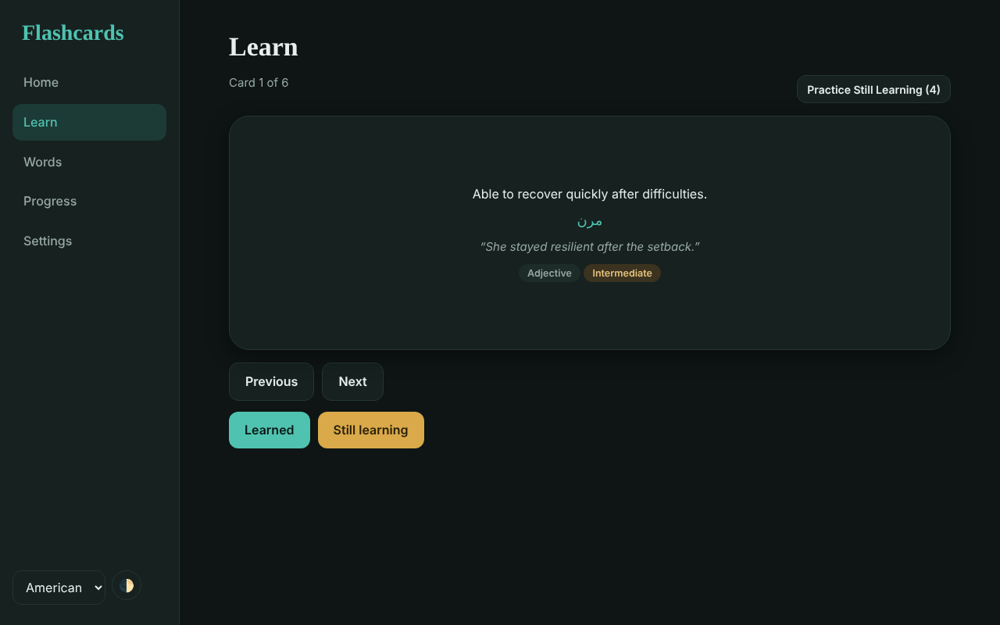</td>
</tr>
</table>

> The screenshots use a small set of demo words so you can see the app with content. A fresh copy of the app contains **no** words. You add them all yourself.

---

## How to use it

### 1. Add your first words

Open **Words** and press **Add a word** (or **Add your first word** on the empty screen).

<table>
<tr>
<td width="55%">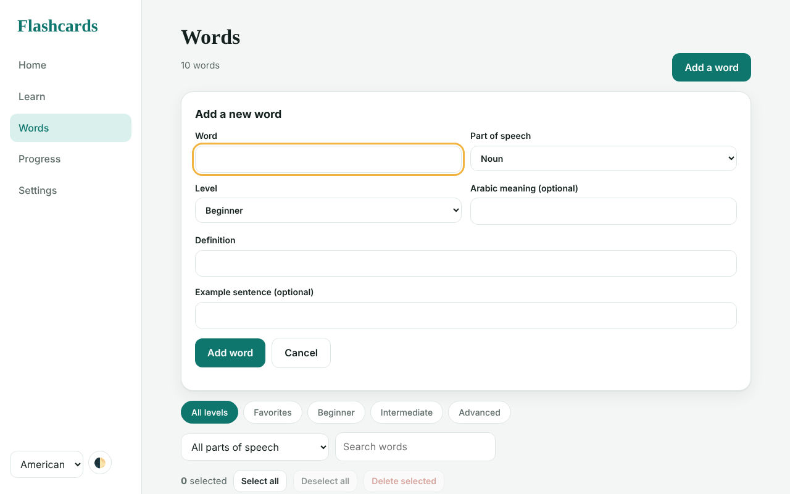</td>
<td valign="top">

| Field | Notes |
|---|---|
| **Word** | Required. Duplicates are blocked. |
| **Part of speech** | 17 options: Noun, Verb, Adjective, Adverb, Pronoun, Preposition, Conjunction, Interjection, Article, Determiner, Auxiliary Verb, Modal Verb, Numeral, Particle, Infinitive Marker, Gerund, Participle. |
| **Level** | Beginner, Intermediate or Advanced. |
| **Definition** | Required. A simple English definition. |
| **Arabic meaning** | Optional. |
| **Example sentence** | Optional. |

</td>
</tr>
</table>

You can **edit** or **delete** any word later, and tap the ★ to mark a favorite.

### 2. Browse and organize

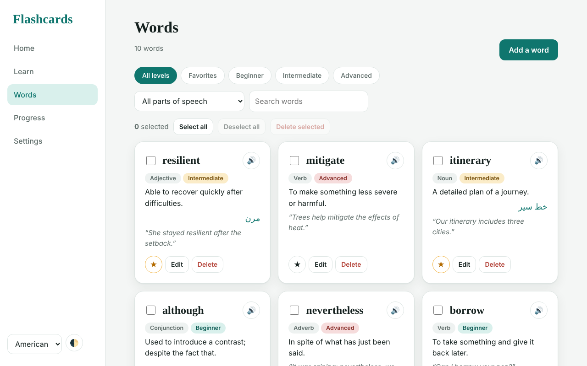

- **Filter chips:** *All levels · Favorites · Beginner · Intermediate · Advanced*.
- **Part of speech** drop-down with all 17 categories, plus a **search box**.
- The header shows your total word count (and how many match the current filters).
- **Select several words** with the checkboxes, or use **Select all**, **Deselect all** and **Delete selected (n)**. A confirmation appears before anything is deleted, including when you delete the entire collection.

### 3. Learn with flashcards

<table>
<tr>
<td width="50%" valign="top">

Open **Learn**. The front of the card shows the word, its part of speech and a 🔊 button. **Tap or click the card** (or press <kbd>Enter</kbd> / <kbd>Space</kbd>) to flip it and reveal the definition, your Arabic meaning, the example and the tags.

Then choose:

- **Learned**: you know this word.
- **Still learning**: you want to see it again.

Use **Previous** and **Next** to move around (keyboard arrows <kbd>←</kbd> <kbd>→</kbd> work too). A counter shows *Card 3 of 12*.

</td>
<td align="center">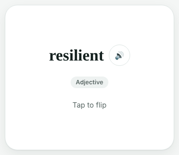</td>
</tr>
</table>

A Learn session contains every word that is **not** yet Learned. When you have marked the **last card** of the session, a celebration appears automatically.

### 4. Practice the words that haven't stuck

Press **Practice Still Learning** on the Learn page. This is a separate session with only the words you marked as Still learning:

| Button | What happens |
|---|---|
| **Remembered** | The word moves to your *learned* list and leaves the practice session. |
| **Still Learning** | The word stays exactly where it is and remains in practice until you finally press Remembered. |

There is a **Shuffle** toggle in Practice if you want a random order. When the last word is remembered, the celebration appears.

<div align="center">
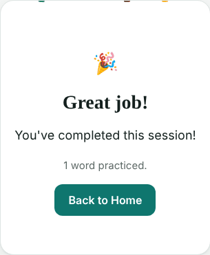
<br><sub>Finish a session and the celebration appears immediately, even with a single word.</sub>
</div>

If nothing is marked Still learning, Practice shows a friendly empty state instead.

### 5. Watch your progress

<table>
<tr>
<td width="60%">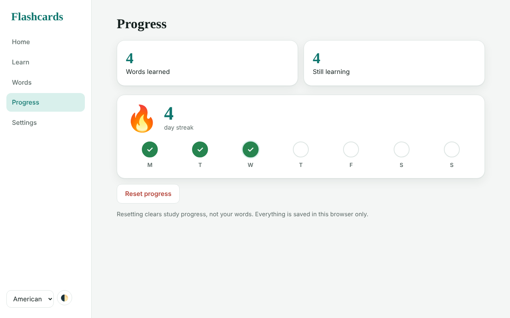</td>
<td valign="top">

- **Words learned** and **Still learning** counters.
- A **streak card** with a big 🔥 and your current day streak.
- Seven circles, **M T W T F S S**, for the current week. Green with a ✓ means you studied that day.

</td>
</tr>
</table>

**Reset progress** clears study activity and sets every word back to *new*. Your words themselves stay.

### 6. Back up and restore

<table>
<tr>
<td width="55%">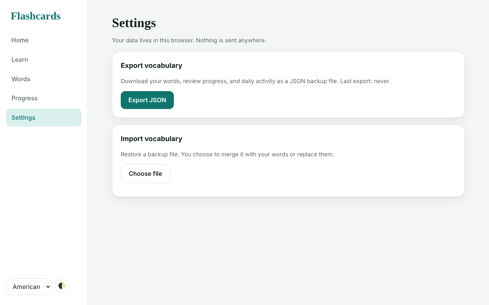</td>
<td valign="top">

- **Export JSON** downloads a backup of your words, their status, review progress and daily activity, and shows the time of your last export.
- **Import** reads a backup, validates it, then lets you choose **Merge** (add new words, keep what you have) or **Replace** (overwrite, with a confirmation).

</td>
</tr>
</table>

---

## How a word moves through the app

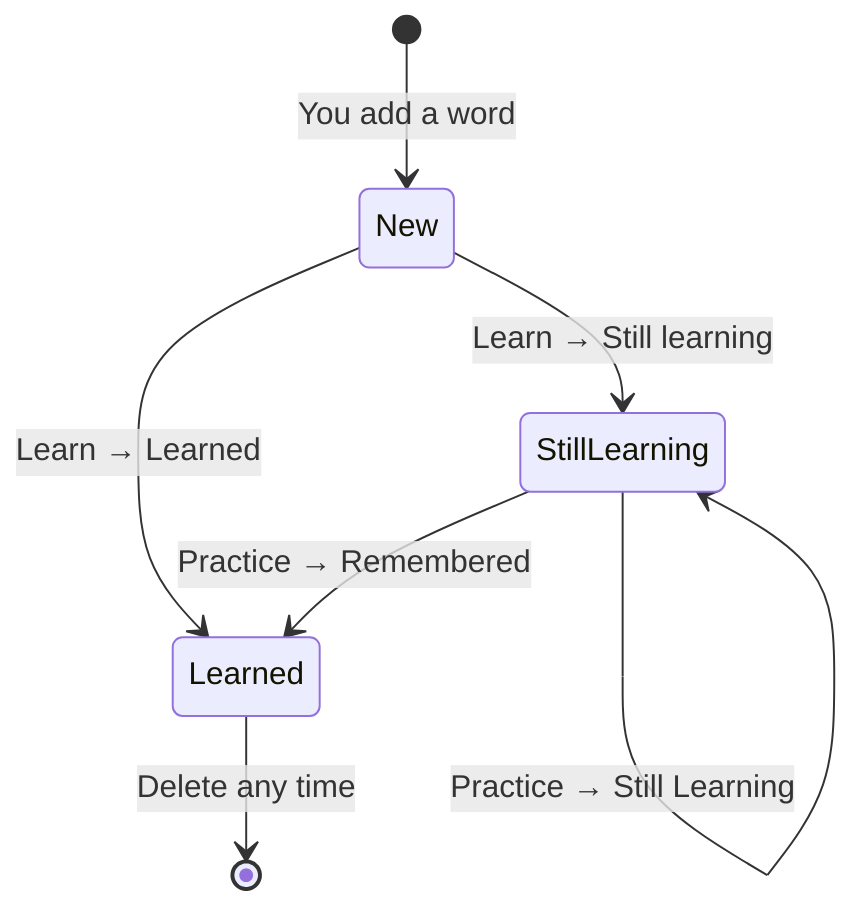

- *Learn* shows every word that is not Learned.
- *Practice* shows only **Still learning** words.
- A word leaves *Still learning* only when you press **Remembered** (in Practice) or **Learned** (in Learn).

---

## How the streak works

| Question | Answer |
|---|---|
| What counts as a study day? | At least one **Learn** (Learned / Still learning) or **Practice** (Remembered / Still Learning) action on that calendar date. |
| Does opening the app count? | No. Neither does flipping, shuffling, or editing words. |
| How does the streak grow? | It counts **consecutive** days with activity, going backwards from today (or from yesterday if you haven't studied yet today). |
| What if I miss a day? | The streak returns to 0 and restarts at 1 the next time you study. |
| Which week is shown? | The current calendar week, **Monday to Sunday**. Earlier weeks are still saved and still count toward the streak. |
| What is "a day"? | Your device's **local date**. A new day starts at your local midnight. |

---

## Pronunciation

Every word has a 🔊 button that says **the word only** (never the definition or example). It uses your browser's built-in text-to-speech, so there are **no API keys and no paid services**.

- Choose **American** or **British** English from the accent menu. Your choice is remembered.
- The app picks the best English voice available on your device.
- Voice quality depends on your operating system and browser; some devices have more natural voices than others.

---

## Light & dark mode

Tap the 🌓 button to switch themes. The choice is saved, and if you haven't chosen yet the app follows your system setting.

<table>
<tr>
<td align="center"><b>Light</b></td><td align="center"><b>Dark</b></td>
</tr>
<tr>
<td>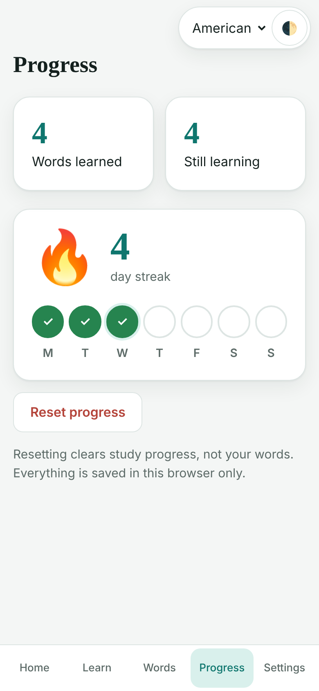</td>
<td>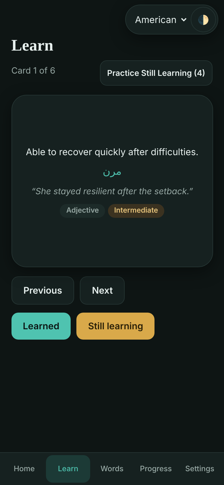</td>
</tr>
</table>

The layout adapts from small phones to wide desktop monitors: a sidebar on larger screens, and a bottom navigation bar on phones.

<table>
<tr>
<td align="center">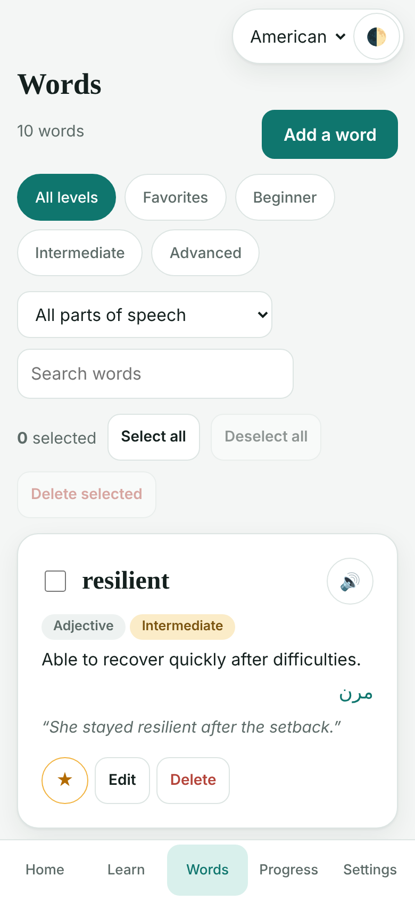</td>
<td align="center">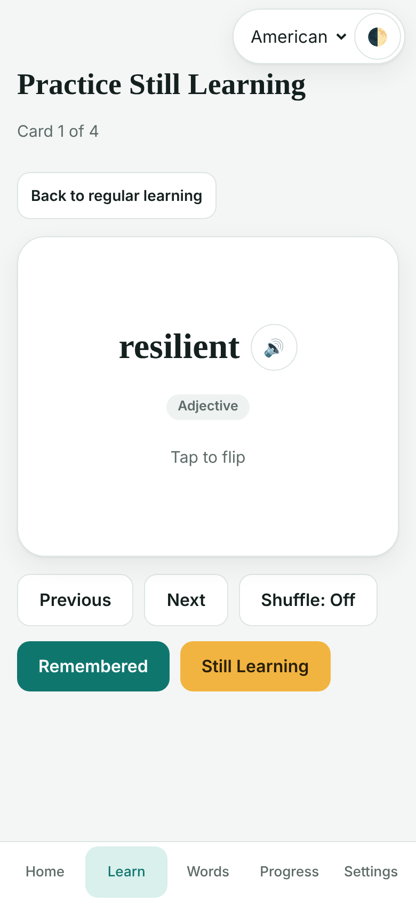</td>
<td align="center">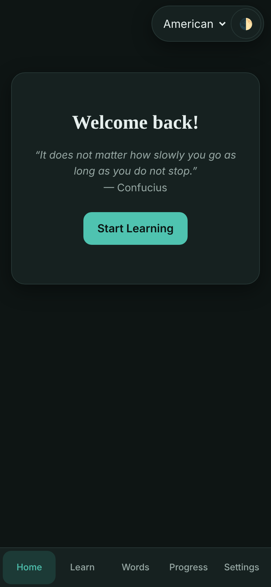</td>
</tr>
</table>

---

## Your data and privacy

- Everything is saved in your browser's **localStorage**. Nothing is sent to any server.
- Your words, statuses, daily activity, theme and accent survive closing the browser and restarting your computer.
- **Clearing site data removes everything.** Clearing only the cache does not.
- Data belongs to one browser on one device (and one web address). It does **not** sync between devices.
- Private/incognito windows forget everything when closed.
- Use **Settings → Export JSON** regularly if your words matter to you.

---

## Install it as an app

Flashcards is a **Progressive Web App**.

- **Chrome / Edge (desktop and Android):** use the install icon in the address bar, or the browser menu → *Install app*.
- **iPhone / iPad (Safari):** Share → *Add to Home Screen*.

After the first successful visit the app files are cached, so it is designed to keep working **offline**. Because everything runs locally, your cards and progress are available without a connection.

---

## Run it yourself

No build step and no dependencies.

```bash
# from the project folder
python3 -m http.server 8000
# then open http://localhost:8000
```

Any static file server works. The service worker needs `http://localhost` or HTTPS (it does not run from `file://`).

**Deploy to GitHub Pages:** push the project to a repository and enable Pages for the branch. All paths are relative, so it works from a repository subpath.

---

## Project structure

```text
├── index.html          App shell and navigation
├── styles.css          Design system (CSS variables, light/dark themes)
├── app.js              Views, storage, flashcards, practice, import/export
├── service-worker.js   Offline caching
├── manifest.json       PWA name, icons, colors
├── icons/              192×192 and 512×512 app icons
└── docs/               Screenshots and animations used in this README
```

**Built with:** HTML5 · CSS3 · vanilla JavaScript · Web Speech API · localStorage · Service Worker.

---

## FAQ

<details>
<summary><b>Why does the app start with no words?</b></summary>

By design. It is a personal collection, so you decide what to learn. Nothing is imported or generated automatically.
</details>

<details>
<summary><b>My progress disappeared. What happened?</b></summary>

Browser data was probably cleared, or you opened the app in a different browser, device, private window or web address. Restore from a JSON backup in **Settings → Import**.
</details>

<details>
<summary><b>Can I move my words to another device?</b></summary>

Yes: export a backup on the first device, then import it on the second.
</details>

<details>
<summary><b>The pronunciation sounds robotic or is missing.</b></summary>

Voices come from your device. Try the other accent, or install higher-quality English voices in your system settings.
</details>

<details>
<summary><b>I installed the app but the name or icon looks old.</b></summary>

Android can take a while to refresh. On iPhone, remove the home-screen icon and add it again.
</details>

---

<div align="center">
<sub>Made for learners who want a simple, private place to grow their English vocabulary.</sub>
</div>
